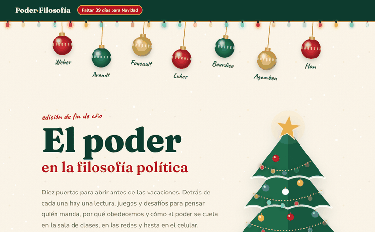

# El poder en la filosofía política



Plataforma web para un curso de Filosofía de Educación Media. Cada clase tiene un texto base, una lectura sugerida y desafíos (selección múltiple + respuesta abierta). Las entregas y notas se guardan en Firebase, y la nota final se calcula en escala 1,0–7,0 con 60 % de exigencia.

## Recorrido del curso

| # | Clase | Autor | Puntos |
|---|-------|-------|--------|
| # | Clase | Autor | Juego | Puntos |
|---|-------|-------|-------|--------|
| 1 | ¿Qué es el poder? | Introducción (Dahl) | Clasificar en sacos | 9 |
| 2 | Poder, dominación y legitimidad | Max Weber | Clasificar en sacos | 9 |
| 3 | Poder y violencia | Hannah Arendt | Emparejar | 9 |
| 4 | Vigilar y disciplinar | Michel Foucault | Clasificar en sacos | 9 |
| 5 | Biopoder: gobernar la vida | Michel Foucault | Clasificar en sacos | 9 |
| 6 | Las tres dimensiones del poder | Steven Lukes | Clasificar en sacos | 9 |
| 7 | Capital y violencia simbólica | Pierre Bourdieu | Emparejar | 9 |
| 8 | El estado de excepción | Giorgio Agamben | Ordenar | 9 |
| 9 | Rendimiento y psicopolítica | Byung-Chul Han | Clasificar en sacos | 9 |
| 10 | Síntesis: el poder hoy (ensayo final) | Integrador | Emparejar | 15 |
| | **Total** | | | **96** |

Cada clase tiene:
- **Memorice de calentamiento** (no evaluado) para repasar conceptos.
- **3 preguntas de alternativas** (1 pt c/u, se autocorrigen).
- **1 juego** (2 pts, se autocorrige con puntaje parcial): clasificar tarjetas en sacos, emparejar conceptos u ordenar pasos. Funciona arrastrando con el mouse o tocando en el celular.
- **1 desafío escrito** (4 pts, lo corrige el docente con rúbrica). La clase 10 tiene un ensayo de 10 pts.

**Nota final** = puntos acumulados ÷ 96, en escala chilena (60 % = 4,0). Las clases no entregadas cuentan 0.

## Diseño navideño

- Inicio como **calendario de adviento**: cada clase es una puerta que se abre (con el cursor o tocándola en el celular). Las entregadas quedan envueltas como regalo y las corregidas llevan una estrella dorada.
- Nieve que cae, guirnalda de luces, esferas que se balancean, bastón de caramelo como barra de avance y confeti al enviar.
- **Trineo del Viejo Pascuero con tres renos** que cruza el cielo cada medio minuto (los renos galopan).
- **Árbol de Navidad** con luces que parpadean, estrella brillante, esferas y regalos (en la portada y en el inicio).
- **Suelo nevado** al pie de cada página: un reno que camina de un lado a otro, un mono de nieve que saluda, bastones de caramelo y otro arbolito.
- **Cuenta regresiva** a Navidad en la barra superior (aparece desde fines de octubre y se oculta sola después de Año Nuevo).
- Nieve acumulada sobre las tarjetas.
- Todas las ilustraciones son dibujos SVG originales (`js/escena.js`), sin imágenes externas.
- Las animaciones se apagan solas si el dispositivo tiene activado "reducir movimiento".
- **Para quitar la Navidad** (por ejemplo, en marzo): `navidad: false` en `js/contenido.js`.
- **GIF propios:** guarda tus GIF en `img/` y agrégalos con `gifPortada: "img/mi.gif"` (portada) o `gif: "img/clase3.gif"` dentro de una clase.
- Las tipografías (Fraunces, Nunito y Caveat, licencia libre OFL) vienen incluidas en `fonts/`.

## Cómo funciona

- **Estudiantes** (`index.html`): entran con Google, completan nombre y curso, ven las clases abiertas, leen, responden y envían (una sola vez). Ven su puntaje, comentario y nota acumulada.
- **Docente** (`docente.html`): abre/cierra clases, importa las claves, corrige entregas (la selección múltiple viene precalificada), deja comentarios, permite reenvíos y exporta el libro de notas a CSV/Excel.
- Las opciones de selección múltiple se muestran en distinto orden a cada estudiante.
- Las respuestas correctas **no** están en el código público: van en `privado/claves.json` (excluido de Git) y se suben a Firestore desde el panel.

## Puesta en marcha (≈15 minutos)

### 1. Firebase
1. En la [consola de Firebase](https://console.firebase.google.com) abre tu proyecto (o crea uno).
2. **Authentication → Método de acceso → Google → Habilitar.**
3. **Firestore Database → Crear base de datos** (modo producción, región `southamerica-east1` o la que prefieras).
4. **Configuración del proyecto → Tus apps → Web (`</>`)**: registra una app y copia el objeto `firebaseConfig`.

### 2. Configurar el código
1. Pega tu `firebaseConfig` en `js/firebase-config.js`.
2. En ese mismo archivo, pon tu correo en `DOCENTES`.
3. En `firestore.rules`, reemplaza `docente@ejemplo.cl` por tu correo (el mismo).
4. (Opcional) Si tus estudiantes tienen correo institucional, define `DOMINIO_PERMITIDO = "@tucolegio.cl"`.

### 3. Subir a GitHub
```bash
git remote add origin https://github.com/TU-USUARIO/poder-filosofia-politica.git
git push -u origin main
```
`privado/` no se sube (está en `.gitignore`). Guarda `privado/claves.json` en tu computador.

### 4. Publicar en Firebase Hosting
```bash
npm install -g firebase-tools
firebase login
firebase use --add            # elige tu proyecto
firebase deploy               # sube reglas + sitio
```
Tu sitio queda en `https://TU-PROYECTO.web.app`.

> **Deploy automático desde GitHub (opcional):** ejecuta `firebase init hosting:github` y Firebase creará la GitHub Action para que cada `git push` publique el sitio.
>
> **Alternativa GitHub Pages:** también funciona (Settings → Pages → rama `main`). Agrega el dominio `TU-USUARIO.github.io` en Authentication → Configuración → Dominios autorizados. Las reglas igual se suben con `firebase deploy --only firestore:rules`.

### 5. Primer uso como docente
1. Entra al sitio con tu cuenta y ve a **Panel docente**.
2. **Importa `privado/claves.json`**.
3. **Marca la clase 1 como abierta** y guarda.
4. Comparte el enlace con tus estudiantes.

## Personalizar

- **Textos, lecturas, juegos y desafíos:** `js/contenido.js`. Si cambias una pregunta de alternativas o un juego, actualiza también `privado/claves.json` y vuelve a importarlo:
  - alternativas → índice de la opción correcta (desde 0)
  - clasificar → `{ "a": 0, "b": 2, … }` (ítem → índice de categoría)
  - emparejar → `{ "a": 3, … }` (elemento de la izquierda → índice en la lista de la derecha)
  - ordenar → `["b", "d", "a", "c"]` (ids en el orden correcto)
- **Memorice:** campo `memorice` de cada clase (pares de textos).
- **Exigencia o escala:** objeto `CURSO` en `js/contenido.js`.
- **Puntaje de preguntas abiertas:** 4.º argumento de `abierta(...)`.
- **Estilos:** `css/estilos.css`.

## Estructura

```
├── index.html          Inicio del estudiante (clases y nota)
├── clase.html          Lectura + desafíos de una clase
├── docente.html        Panel docente
├── js/
│   ├── contenido.js    Contenido del curso (editable)
│   ├── juegos.js       Clasificar, emparejar, ordenar, memorice, confeti
│   ├── decor.js        Nieve, luces y adornos
│   ├── escena.js       Renos, trineo, árbol, mono de nieve, suelo nevado
│   ├── firebase-config.js
│   ├── base.js         Firebase + utilidades + cálculo de nota
│   ├── inicio.js · clase.js · docente.js
├── css/               estilos.css + fuentes.css
├── fonts/             Tipografías incluidas
├── img/               demo.gif y tus GIF
├── firestore.rules     Seguridad (quién lee/escribe qué)
├── firebase.json
└── privado/claves.json Respuestas correctas (NO va a GitHub)
```

## Modelo de datos (Firestore)

| Colección | Documento | Quién escribe |
|-----------|-----------|---------------|
| `config/curso` | `{ clasesAbiertas: ["c01", …] }` | Docente |
| `estudiantes/{uid}` | nombre, sección, correo | El propio estudiante |
| `entregas/{uid}_{clase}` | respuestas, fecha | Estudiante (una vez, clase abierta) |
| `calificaciones/{uid}_{clase}` | puntos, detalle, comentario | Docente |
| `claves/{clase}` | respuestas correctas | Docente (solo él/ella lee) |

## Sobre las lecturas

Los textos base de cada clase son explicaciones originales para estudiantes de Media. Las lecturas sugeridas son referencias bibliográficas: el docente entrega el fragmento correspondiente (fotocopia, PDF del CRA, etc.) según los derechos de cada edición.
